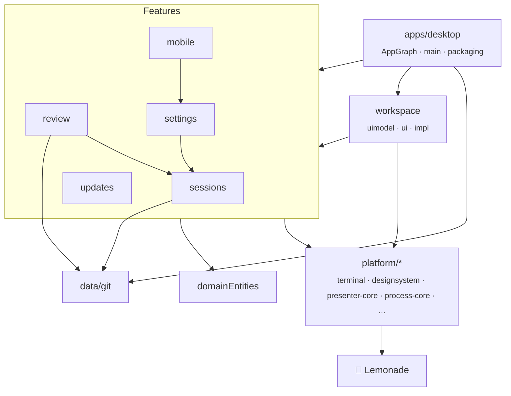
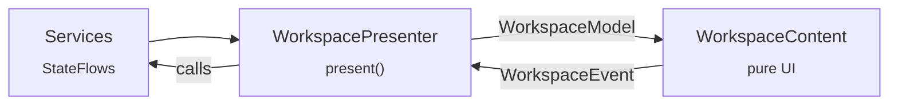

# Architecture

How the code is organised. For what the app does at runtime, see [How it works](HOW-IT-WORKS.md).

Lemonade Code is a **Kotlin Multiplatform** app with a **Compose Multiplatform** desktop (JVM) target,
the [Lemonade](https://github.com/teya-engineering/lemonade-design-system) design system, and the
architecture of `teya-business-app`: domain models, data sources, features split into
`api` / `impl` / `fake`, Molecule presenters, Metro compile-time dependency injection, and fakes
instead of mocks.

---

## The big picture

Arrows point at what a module depends on. Each feature is three modules:

| Part | Holds | May depend on |
|---|---|---|
| `api` | Interfaces and their models | `platform/*`, `domainEntities` |
| `impl` | The implementation | Its own `api`, other features' `api`s, data `api`s, `platform/*` |
| `fake` | Fakes for tests | Its own `api` |

An `impl` never depends on another `impl`. Bindings are contributed with
`@ContributesBinding(AppScope::class)` next to their implementation, and `AppGraph` in
`apps/desktop` is the only place they all meet.

---

## Modules

| Module | What it holds |
|---|---|
| `build-logic/convention` | Gradle convention plugins: `lemonadecode.kmp.base` (desktop target, Metro, `explicitApi()`, return-value checker, Spotless), `.library`, `.compose`, `.uimodel`, `.feature`, `.serialization`. |
| `platform/core` | `LemonadeCodeResult` and `safeSuspendRunCatching` (which rethrows cancellation). |
| `platform/di-core` | `AppScope`. |
| `platform/architecture-core` / `-test` | `LemonadeCodeCoroutineDispatchers`, the app `CoroutineScope`, `AppInitializer`; test dispatchers. |
| `platform/presenter-core` / `-test` | `LemonadeCodePresenter<Model>`, `PresenterHost` (Molecule, immediate mode), `presenterAsState`; `presenter.test { }`, `awaitItemWhere`, `yieldUntil`. |
| `platform/localization-core` | `LemonadeCodeString`: text a presenter puts in a Model, resolved by the UI. `ProvideAppLanguage` draws everything in the language picked in settings. |
| `platform/preferences-core` / `-test` | `PreferenceStore`, a JSON file in the user's app-data folder. |
| `platform/process-core` | `ProcessRunner`, `UserShell`, `HomeDirectory`. |
| `platform/terminal` | `TerminalSession` (pty4j and JediTerm's emulator) and `TerminalView`, a Compose renderer. |
| `platform/syntax-core` | Lightweight code colouring for the diff. |
| `platform/power-core` | Keep-awake for the system and the screen: `caffeinate` on macOS, `systemd-inhibit` plus GNOME's `gnome-session-inhibit` on Linux, PowerShell calling `SetThreadExecutionState` on Windows. |
| `platform/designsystem` | `LemonadeCodeTheme` over Lemonade, plus tooltips, popovers, a context menu and a slot segmented control. See [Design](DESIGN.md#what-lemonade-code-adds). |
| `domainEntities` | Sessions, reviews, diffs, settings, updates. No dependencies. |
| `data/git/{api,impl,fake}` | `GitDataSource` over the `git` command: merge-base diffs with whole-file context, untracked files, worktrees. |
| `sessions/{api,impl,fake}` | `SessionService`: opens login shells in PTYs, follows each shell's folder and branch, infers working / needs input / idle / exited, plans and starts sub-sessions. `SessionTerminals` exposes the terminals to the UI. |
| `review/{api,impl,fake}` | `ReviewService`: the diff and comments per checkout, the review text, pasting it into the session or into a review sub-session. |
| `settings/{api,impl,fake}` | `SettingsService` (persisted) and the keep-awake coordinator. |
| `updates/{api,impl,fake}` | `UpdateService`: finds a newer GitHub release for this install, downloads and checks it, and, on Restart now, hands over to a helper that swaps it in after the app quits. See [RELEASING.md](../RELEASING.md). |
| `mobile/{api,impl,fake}` | `MobileService`, the Mobile plugin: Android devices through `adb` (list, the screen as video from `screenrecord` decoded with FFmpeg, screenshots, input, `logcat`, pairing by QR code or code, mDNS discovery) and iOS devices through libimobiledevice (list, screenshots, `idevicesyslog`, trusting over a cable). Idle while the plugin is off. |
| `workspace/uimodel` | `WorkspaceModel`, `WorkspaceEvent` and the localized strings (`composeResources`: English, German, Spanish, French, Portuguese and Slovak). |
| `workspace/ui` | The composables: `WorkspaceContent(model, terminal)` and its parts, including the file previews. Pure rendering. |
| `workspace/impl` | `WorkspacePresenter`, the Model mapper, `WorkspaceScreen` (presenter plus live terminals), and the showcase built from fixtures through the same mapper. |
| `apps/desktop` | The Metro `AppGraph`, `main` (the main window and the Devices panel's own window, sharing one presenter), and packaging. |
| `sample` | The showcase app and the screenshot renderer. |

---

## Presenters

`WorkspacePresenter.present()` collects the services' `StateFlow`s, keeps only UI state (selection,
popovers, the comment box, folded rows), and returns an immutable `WorkspaceModel` with a remembered
`eventSink`. `WorkspaceScreen` wires it up with `presenterAsState` and draws `WorkspaceContent`.

Errors become a `model.error` banner. Presenters never throw.

The same Model mapper builds the showcase screens from fixed data, so the design showcase and the
real app can't drift apart.

---

## Localization

All copy lives in `workspace/uimodel/src/commonMain/composeResources/values*/strings.xml`, in
English, German, Spanish, French, Portuguese and Slovak. Presenters put `LemonadeCodeString`s in the
Model (`Res.string.x.asLemonadeCodeString(args)`), and composables call `resolve()` or
`stringResource`. The language follows the system locale unless one is picked in Settings ›
Language; `ProvideAppLanguage` sets the default locale and draws everything below it again, so the
change shows at once. `TranslationsTest` checks that every language has every string and plural,
with the same values filled in.

---

## Tests

- **Fakes, not mocks.** Every feature has a `:fake` module. Flows are tested with Turbine and
  presenters with Molecule.
- **Real integrations.** Integration tests run real `git` and real PTYs. `AppGraphSmokeTest` builds
  the real dependency graph, runs a shell and draws the window offscreen
  (`apps/desktop/build/smoke/app.png`).
- **Headless UI tests** with Compose's test rules. `WorkspaceContentUiTest` clicks, hovers, drags
  and types through every design screen and checks the events. `WorkspaceFlowUiTest` drives the real
  presenter and UI together over fakes: open a terminal, comment on a line, paste it, settings,
  sub-sessions, ⌘W.
- **The terminal** tests type into `TerminalView` and check the cursor follows the text and blinks.

How to run them is in [Development](DEVELOPMENT.md).

---

## Libraries

| Library | Used for |
|---|---|
| [Lemonade](https://github.com/teya-engineering/lemonade-design-system) | Design tokens, components, themes |
| [Compose Multiplatform](https://www.jetbrains.com/compose-multiplatform/) | The UI toolkit |
| [Metro](https://github.com/ZacSweers/metro) | Compile-time dependency injection |
| [Molecule](https://github.com/cashapp/molecule) | Presenters as composable functions |
| [pty4j](https://github.com/JetBrains/pty4j) | Pseudo-terminals on macOS, Linux and Windows |
| [JediTerm](https://github.com/JetBrains/jediterm) | The terminal emulator behind `TerminalView` |
| [Turbine](https://github.com/cashapp/turbine) | Testing flows |
| [JavaCV](https://github.com/bytedeco/javacv) and [FFmpeg](https://ffmpeg.org) | Playing videos in file previews (FFmpeg's LGPL build, for the platform the app is built on) |
| [JSVG](https://github.com/weisJ/jsvg) | Drawing SVGs that have text, like badges, which Skia's SVG renderer leaves out |

Versions are in [`gradle/libs.versions.toml`](../gradle/libs.versions.toml).
