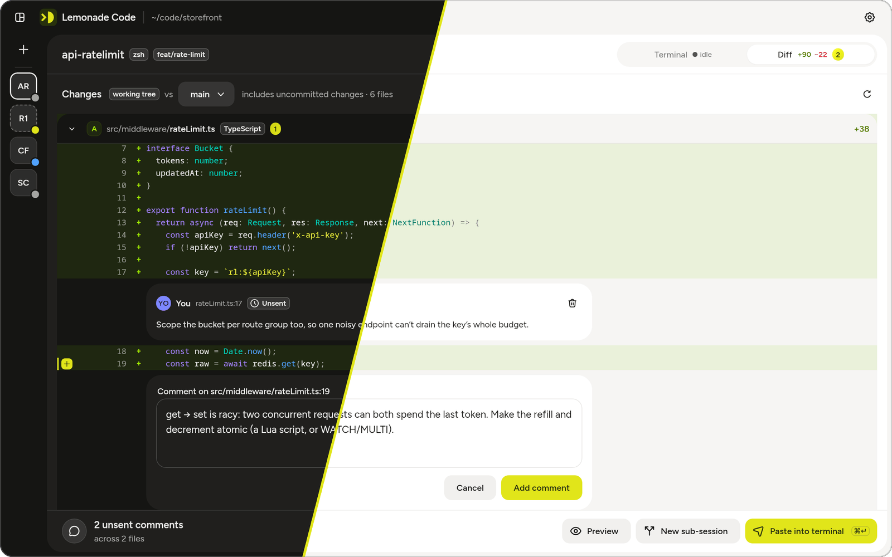
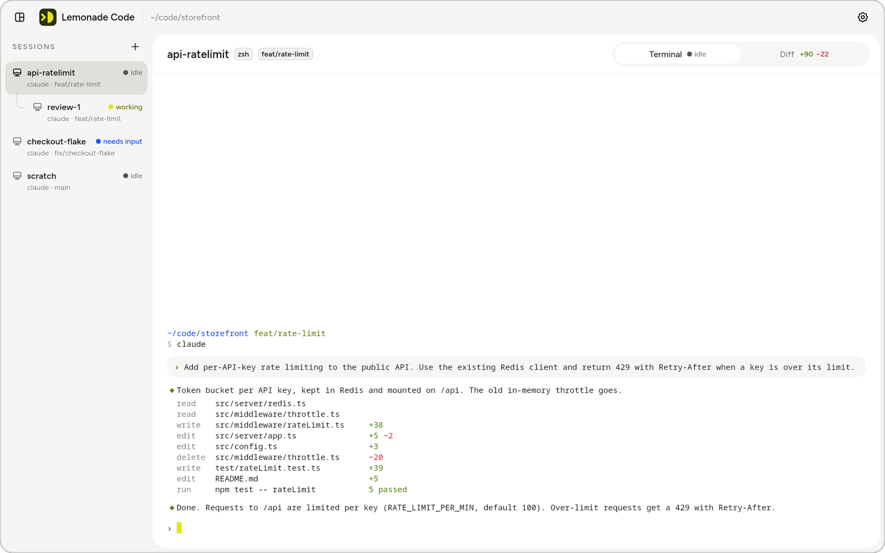
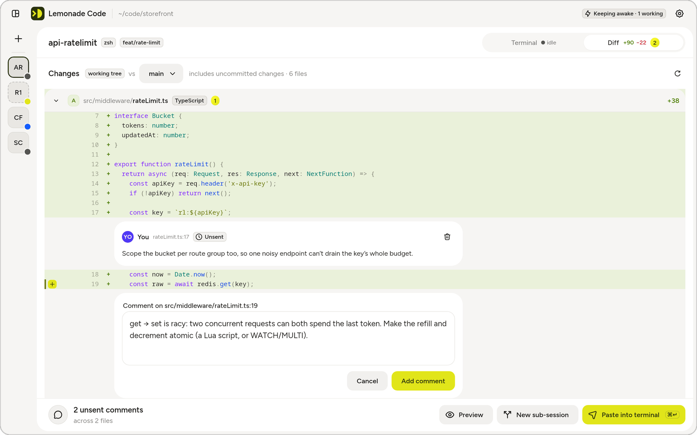
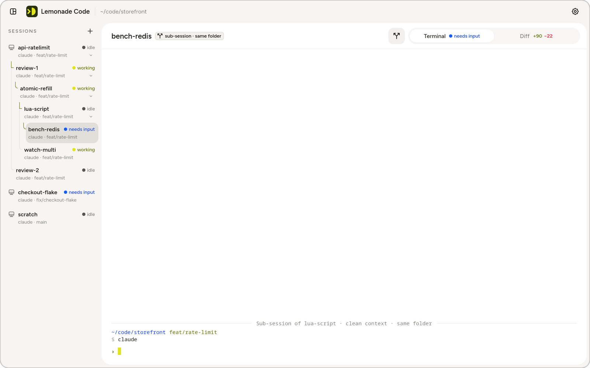
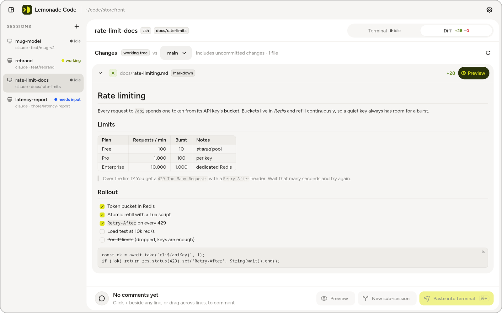
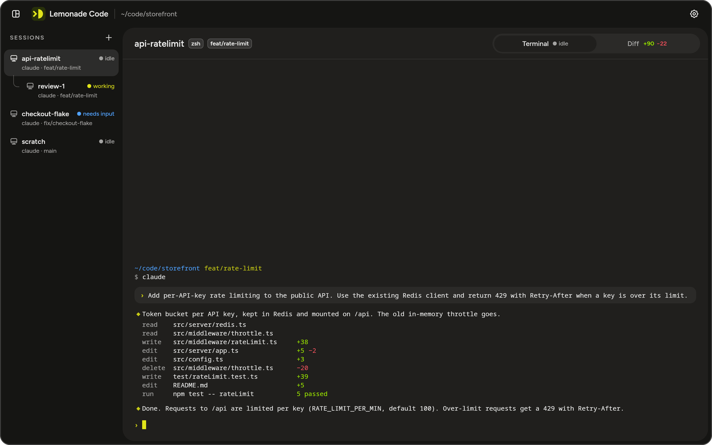
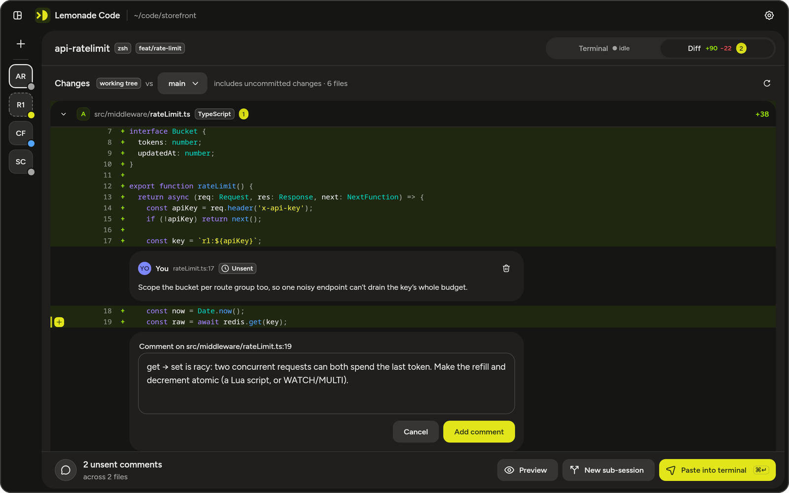
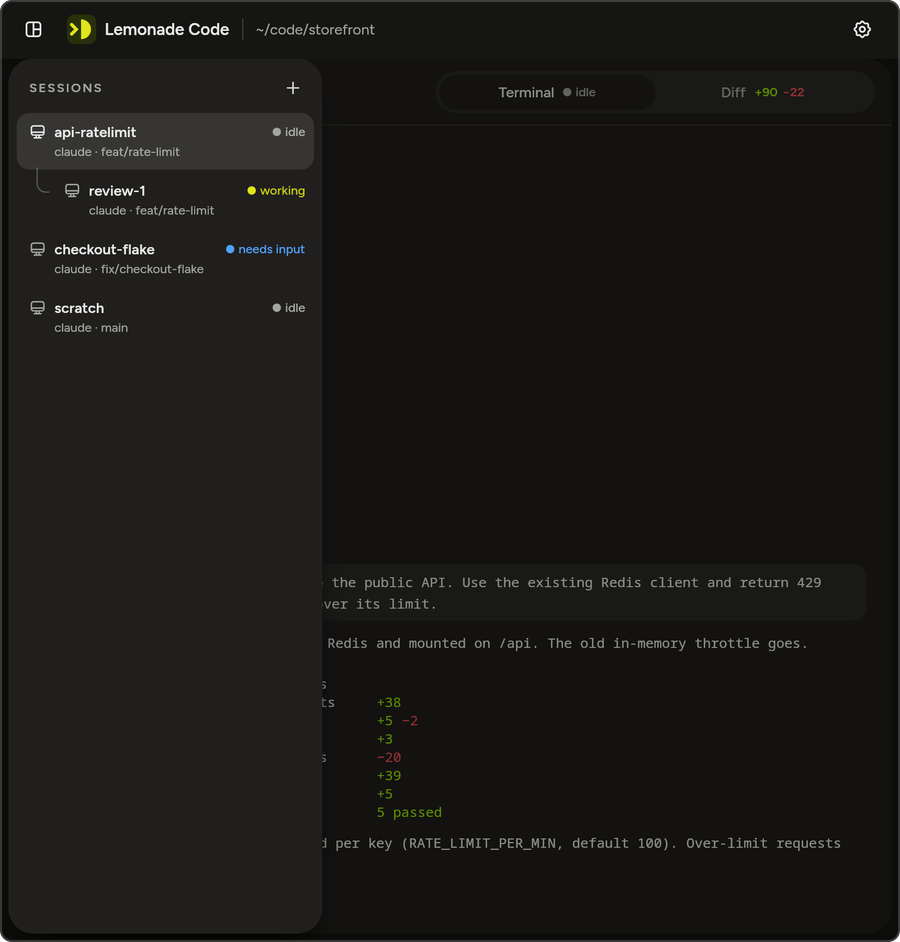
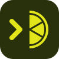

# Design

How Lemonade Code looks, and why it looks that way.

- [Built on Lemonade](#-built-on-lemonade)
- [What comes from Lemonade](#what-comes-from-lemonade)
- [What Lemonade Code adds](#what-lemonade-code-adds)
- [Code colours](#code-colours)
- [Light and dark](#light-and-dark)
- [Layouts](#layouts)
- [Principles](#principles)
- [The icon](#the-icon)
- [Where the design lives](#where-the-design-lives)

---

## 🍋 Built on Lemonade



Lemonade Code stands on the shoulders of
**[Lemonade](https://github.com/teya-engineering/lemonade-design-system)**, the open-source design
system made by **[Teya](https://github.com/teya-engineering)**. In its own words, Lemonade is

> A multi-platform design system providing production-ready UI components, theming capabilities, and
> design tokens for building consistent user experiences across platforms.

It ships one design language to three platforms:

| Platform | What you get |
|---|---|
| **Compose Multiplatform** | Components and tokens for Android, iOS and desktop (JVM). This is what Lemonade Code uses. |
| **SwiftUI** | Components and tokens for iOS and macOS |
| **Web** | Design tokens, typography and icons, from npm |

A few things make Lemonade a joy to build on:

- **Everything is a token.** Colours, type, spacing, radius, shadows, opacity and border widths all
  come from one Figma export, so every platform agrees down to the pixel.
- **Designed first, then built.** Components exist in Figma, and are checked by designers, before they
  are written in code.
- **Documented.** Every public API comes with a description, usage examples and its parameters.
- **Dark and light, out of the box.** `LemonadeDarkTheme` and `LemonadeLightTheme` are complete
  semantic palettes; switching between them is one line.
- **Desktop-ready.** Its Compose library runs on the JVM desktop target, so a desktop app gets the same
  components as a phone app, with no porting.
- **Open source**, under the Apache 2.0 license.

Lemonade Code is, in a real sense, Lemonade on a desktop: the app was rebuilt on Lemonade's dark theme
and even took its name from it. A huge thank you to the Lemonade team at Teya. 💛

**→ [Star Lemonade on GitHub](https://github.com/teya-engineering/lemonade-design-system)**

The app depends on `com.teya.foundation:lemonade-ui` (version in
[`gradle/libs.versions.toml`](../gradle/libs.versions.toml)), which brings Lemonade's core and tokens
along with it.

---

## What comes from Lemonade

### Tokens

| Token group | Where you see it |
|---|---|
| **Colours** (semantic and themed hues) | Every background, text colour and border, in both themes. The lime accents are Lemonade's brand colour. |
| **Typography**: the Figtree typeface | All interface text: session names, buttons, comments, Markdown previews |
| **Spacing** | Every padding and gap, from the sidebar rows to the comment cards |
| **Radius** | Rounded corners on cards, popovers, buttons and previews |
| **Shadows** | Popovers, menus and the floating panels |
| **Opacity** | The scrim behind the narrow-window drawer |

### Components

| Lemonade component | In Lemonade Code |
|---|---|
| `Button` | *Add comment*, *Paste into terminal*, *Create sub-session*, *Update and restart*, *Play* in Settings › Sounds |
| `IconButton` | Settings, refresh, the sidebar toggle, 3D zoom controls |
| `Icon` and `LemonadeIcons` | Every icon in the app |
| `Text` | Every piece of interface text |
| `Tag` | `zsh`, `feat/rate-limit`, `TypeScript`, `working tree`, *Keeping awake* |
| `Badge` | The yellow unsent-comment counts |
| `Chip` | The *Preview* and *Full file* toggles on a changed file |
| `Card` | Comments and the comment box |
| `SymbolContainer` | Comment avatars and the comment counter in the send bar |
| `SegmentedControl` | *Dark / Light / System*, *Same folder / New worktree*, *Before / After / Side by side* |
| `Switch` | *Keep awake while sessions work*, *Sounds* |
| `TextField` | Renaming a session |
| `TextArea` | Writing a comment |
| `Spinner` | Running tools, loading previews, downloading updates |
| `Toast` | Short confirmations, like a copied folder path |
| `Link` | *What's new*, *Dismiss* on error banners, and *show the full file* in long diffs |
| `HorizontalDivider` | Rules in the settings panel and in Markdown previews |

---

## What Lemonade Code adds

A desktop IDE needs a few things a mobile-first design system doesn't have yet. Each one lives in
[`platform/designsystem`](../platform/designsystem) and is drawn entirely with Lemonade's tokens, so it
fits right in.

| Piece | Why it exists |
|---|---|
| `SlotSegmentedControl` | Lemonade's segmented control takes a label or an icon. The *Terminal / Diff* switcher needs a status dot, diff stats and a badge inside each tab, so this one mirrors Lemonade's track, thumb and hover tints with free-form content. |
| `HoverTooltip` | Lemonade's tooltip host is a spotlight, coach-mark style overlay. A desktop app also wants small labels that show while the mouse rests on a button. |
| `ContextMenuPopover` | Lemonade's list items are sized for touch. Right-click menus need tighter rows, so these are drawn here, styled like Lemonade's popovers. A destructive row, like *Close session*, takes Lemonade's critical content colour. |
| `AnchoredPopover` | Panels that open under their button and close on a click outside or Escape: settings, updates, new sub-session. |
| `StatusDot`, `DotLabel` | The dot-plus-word status pattern used everywhere (see [Principles](#principles)). |
| `KeyHint` | The little `⌘↵` inside the *Paste into terminal* button. |
| `Hairline` | A thin rule for toolbars; Lemonade's dividers only come in the low-contrast border colour. |
| `LemonadeCodeMark` | The app's logo at small sizes, in the top bar. |

`LemonadeCodeTheme` wraps Lemonade's theme and adds the three roles Lemonade has no token for: code
colours, monospace type (13 sp on 20 sp lines for code) and the scrim.

---

## Code colours

Syntax colours are Lemonade's themed hues, so code stays readable and on-brand in both themes.

| Code | Lemonade colour |
|---|---|
| Keywords | violet |
| Strings | yellow-lime |
| Numbers | orange |
| Functions | blue |
| Types | teal |
| Comments | tertiary content |
| Punctuation | secondary content |
| Paths in the terminal | blue |
| Branches in the terminal | brand |

---

## Light and dark

The app opens in dark, the theme it was designed in. Light and *follow the system* are one click away
in Settings.

<table>
<tr>
<td width="50%"></td>
<td width="50%"></td>
</tr>
<tr>
<td width="50%"></td>
<td width="50%"></td>
</tr>
</table>

---

## Layouts

The window adapts to its width.

| Layout | When | What changes |
|---|---|---|
| **Sidebar** | The default | Sessions in a resizable column with names, status and branch |
| **Rail** | Sidebar collapsed | Sessions shrink to initials with a status dot, giving the diff more room |
| **Drawer** | Narrower than 960 dp | Sessions slide in over a flat scrim; toolbars wrap; a dot on the toggle flags a session that needs input |

<table>
<tr>
<td width="38%"></td>
<td width="38%"></td>
<td width="24%"></td>
</tr>
<tr>
<td align="center"><sub>Sidebar</sub></td>
<td align="center"><sub>Rail</sub></td>
<td align="center"><sub>Drawer</sub></td>
</tr>
</table>

---

## Principles

A few rules the interface follows everywhere.

- **Status is never colour alone.** Every status is a dot *and* a word: *working*, *needs input*,
  *idle*. It reads the same for everyone, including people who don't see colour the same way.
- **Lime is for what matters most.** The brand colour marks the path to the selected session in the
  tree, the main action on screen and your unsent comment counts. It's used sparingly, so it keeps
  meaning something.
- **Nothing runs without you.** Sending comments pastes them; it never presses Enter.
- **Show before you create.** The new sub-session panel shows the exact folder and branch before
  anything exists.
- **Scrims are flat, never blurred**, following Lemonade.
- **The mark keeps its colours** in both themes, like the app icon.
- **Edit in place.** Renaming happens right in the session menu, with no dialog.

---

## The icon



A prompt chevron followed by half a lemon slice, `> ◗`: a terminal, with a twist of lemon. It's drawn
in Lemonade's yellow-lime 500 (`#E1E51A`) on yellow-lime 900 (`#28310B`), on a 100-unit grid.

[`make_icons.py`](../apps/desktop/icons/make_icons.py) draws it and writes every version: the
SVG above, the macOS `.icns`, the Windows `.ico`, the Linux `.png` and the window icon, with simpler
drawings for 16 and 32 px so they still read. In the app, `LemonadeCodeMark` draws a simplified cut of it for small sizes.

---

## Where the design lives

The screens were designed in Claude Design, in the project *Loupe rebuilt on Lemonade dark theme*
(Loupe was the app's first name). `Loupe.dc.html` holds the canvas of numbered screens, with notes on
how each should behave.

Every one of those screens is rebuilt in code by the **showcase**, through the same code the real app
uses, so the app can be checked against the design side by side:

```sh
./gradlew :sample:run                          # browse every screen, click around
./gradlew :sample:renderScreens                # save each screen as a PNG in sample/build/screens
./gradlew :sample:renderScreens -Ptheme=light  # the same, in the light theme
./gradlew :sample:renderScreens -Plang=pt      # the same, in Portuguese
./gradlew :sample:renderScreens -Plang=sk      # the same, in Slovak
```

The screenshots in these docs come from those renders.
