# Features

Everything Lemonade Code can do, one screen at a time. New here? The [README](../README.md) has the
short tour.

- [Sessions](#sessions)
- [The terminal](#the-terminal)
- [Reviewing changes](#reviewing-changes)
- [Comments](#comments)
- [Sending comments](#sending-comments)
- [Sub-sessions and worktrees](#sub-sessions-and-worktrees)
- [File previews](#file-previews)
- [Devices](#devices)
- [Settings](#settings)
- [Updates](#updates)
- [Sessions come back](#sessions-come-back)
- [Shortcuts](#shortcuts)

---

## Sessions

A session is a terminal. It runs your own login shell and starts in your home folder, exactly like a
new terminal window. Open as many as you like with **+** or **⌘T**.

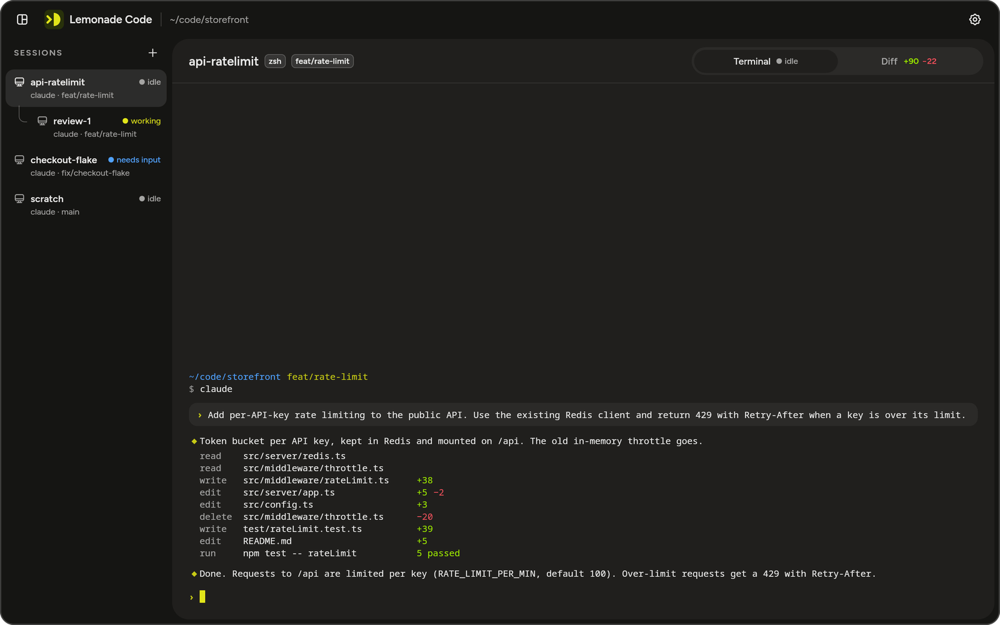

As you `cd` around, Lemonade Code follows along. The session's name, the top bar, the diff and your
comments all switch to the folder and branch the shell is in. While a program runs in it, they follow
the program instead, so when Claude Code moves into a worktree, the session moves with it.

**Status at a glance.** When an agent like Claude Code is running, the session shows what it's doing:

| Status | Meaning |
|---|---|
| 🟡 **working** | The agent (or one of its background agents) is busy. |
| 🔵 **needs input** | Something is waiting for you: a permission, a question or an error. |
| ⚪ **idle** | Done, and waiting for your next message. |

A plain shell shows no status. Under each name you'll see what's running and where, for example
`claude · feat/rate-limit`, or the folder when you're outside a git repository.

**Make room.** Drag the sidebar's edge to resize it; the width is remembered. Collapse it to a slim
rail of initials with the button at the top left. On a narrow window the sessions slide in as a
drawer, and a dot on the toggle tells you when one of them needs input.

<table>
<tr>
<td width="50%">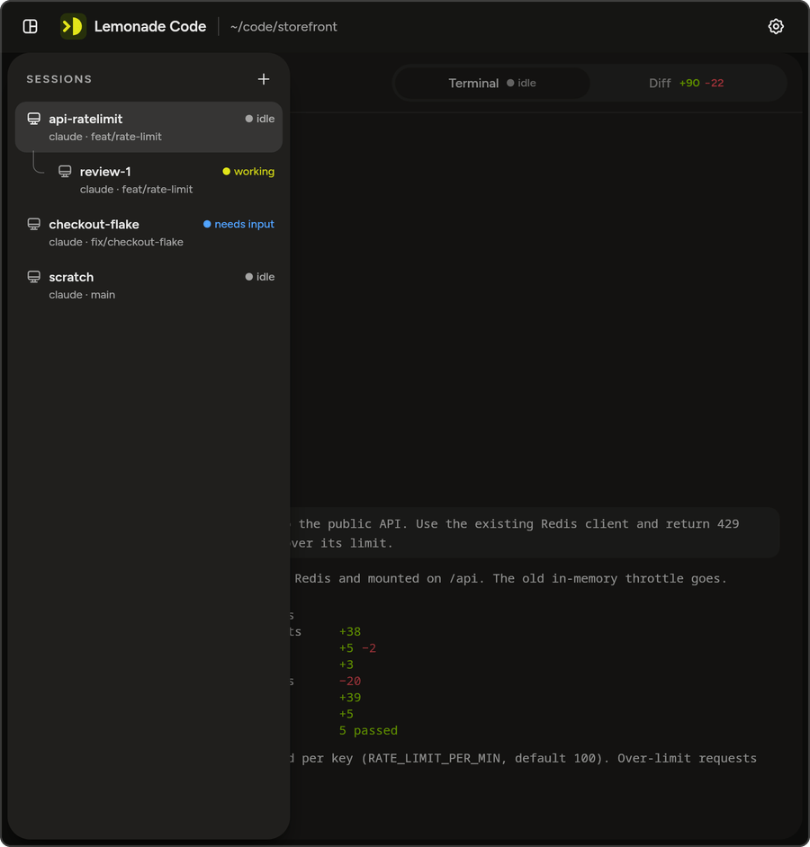</td>
<td width="50%">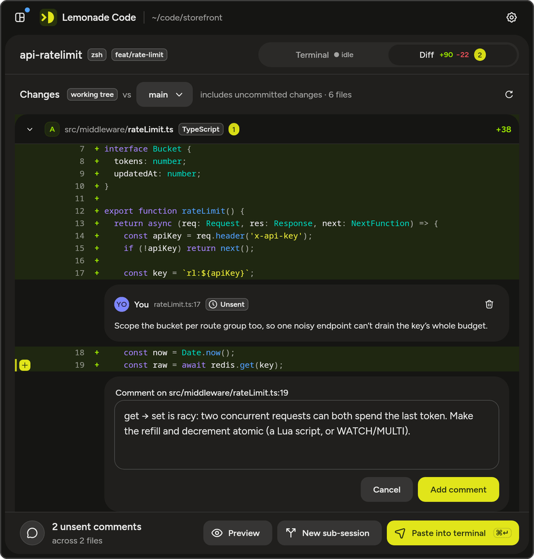</td>
</tr>
<tr>
<td align="center">The drawer, open</td>
<td align="center">Closed, with toolbars that wrap to fit</td>
</tr>
</table>

**Right-click a session** to rename it, copy its folder path, start a sub-session from it, or close
it. Middle-click closes it too. **⌘W** closes the selected session and its sub-sessions.

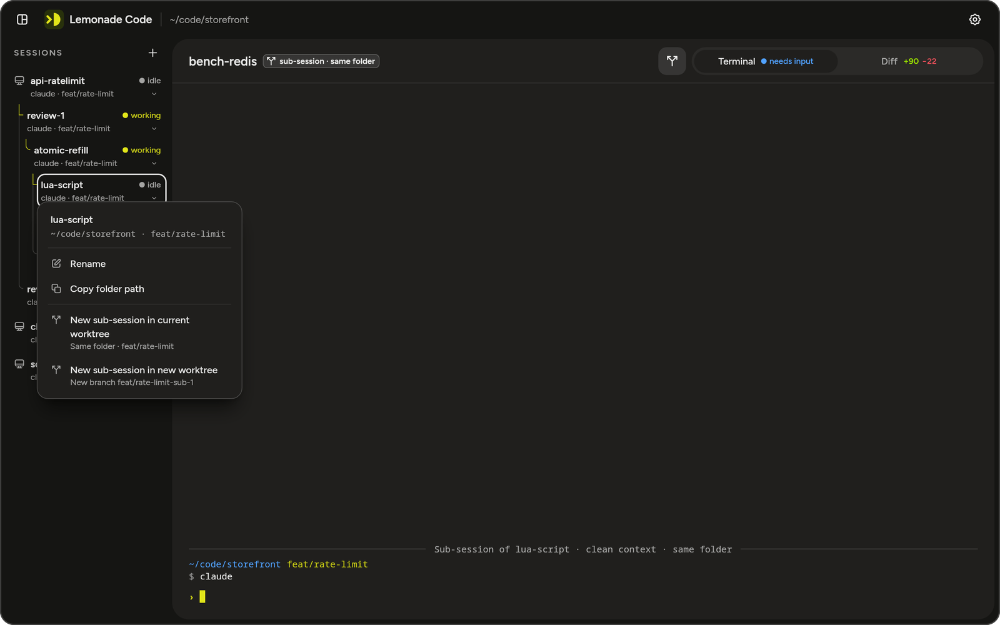

---

## The terminal

It's a real terminal, so everything you already use works: your prompt, your aliases, full-screen
programs and coding agents.

- **Select** by dragging. Double-click selects a word, triple-click a line, and Shift-click extends
  the selection.
- **Copy, paste and select all** with ⌘C, ⌘V and ⌘A on macOS, or Ctrl+Shift+C, Ctrl+Shift+V and
  Ctrl+Shift+A on Windows and Linux.
- **Scroll back** with the mouse wheel. Full-screen programs that handle the mouse themselves, like
  Claude Code's fullscreen mode, get the wheel instead, so it scrolls their own view.
- **Open links** with Ctrl-click (or ⌘-click). That covers web addresses written out, even when they
  wrap onto the next line, and links that programs mark for the terminal. A bare `www.` address
  opens over https. Only web and mail links open; a link to a file shows it in your file manager
  instead of running it.
- **Type in any language.** Dead keys and input methods work like anywhere else, so on an
  international layout `'` then `e` types `é`.

---

## Reviewing changes

Switch a session to the **Diff** tab to see what changed in its folder.

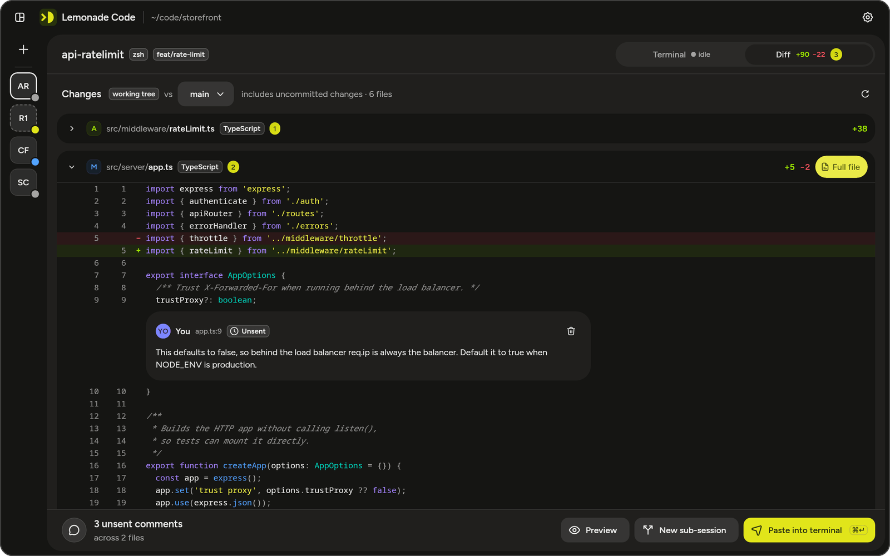

- **Against the right branch.** Changes are compared with `main` by default (or your repository's
  default branch). A sub-session compares with its parent session's branch. Pick any other branch
  from the list next to **vs**: type part of a name to find it, and each branch says when it last
  changed and who made the change. **HEAD** compares with the last commit, so you see only what
  isn't committed yet.
- **Every changed file at a glance.** The list beside the diff names each changed file and its
  comments, and lights up the one you're reading as you scroll. Click a file to jump to it; a folded
  file opens. The list button next to **Changes** hides it. On a narrow window it starts hidden.
- **Everything included.** Uncommitted changes and new files that git doesn't track yet show up too.
- **Readable.** Code is coloured by language, with three lines of context around each change.
- **The whole file.** Press **Full file** to read a changed file top to bottom.
- **Always fresh.** The diff reloads when you open it, when you press refresh, and when the agent in
  the terminal finishes working.

---

## Comments

Review the changes the way you'd review a pull request.

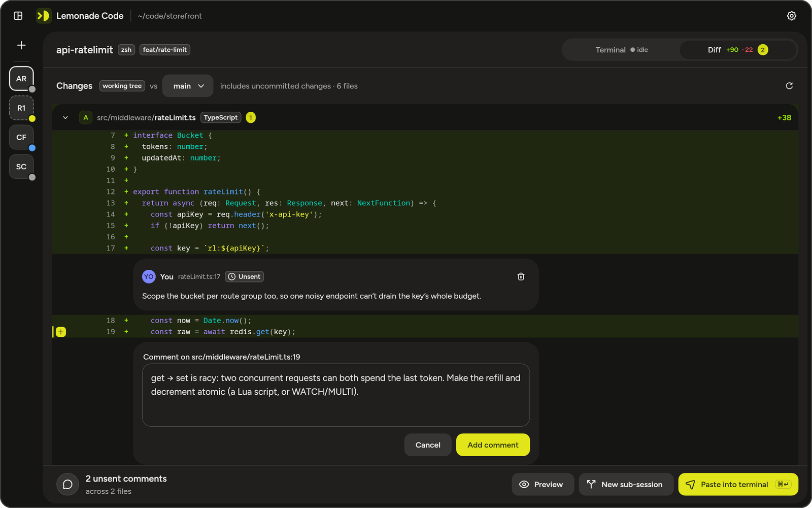

- Click the **+** next to a line to comment on it.
- Drag across lines to comment on a range.
- Comments stay **unsent** until you send them, and the bar at the bottom counts them.
- Press **Preview** to see the exact text that will be sent.

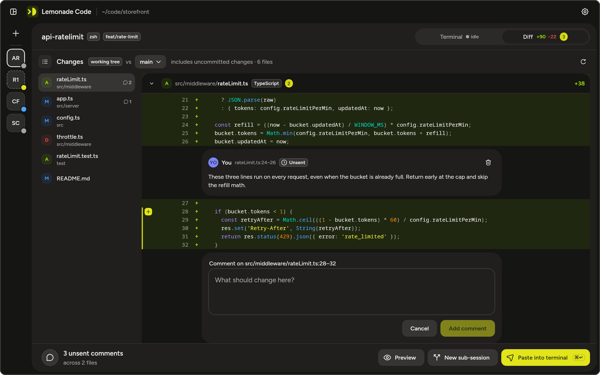

---

## Sending comments

When you're ready, you have two choices.

**Paste into terminal** (⌘↵) pastes all your unsent comments into the program in the terminal, each
with its file and line. It's pasted, not run: nothing happens at a shell prompt, and you press Enter
yourself in whatever program you're using.

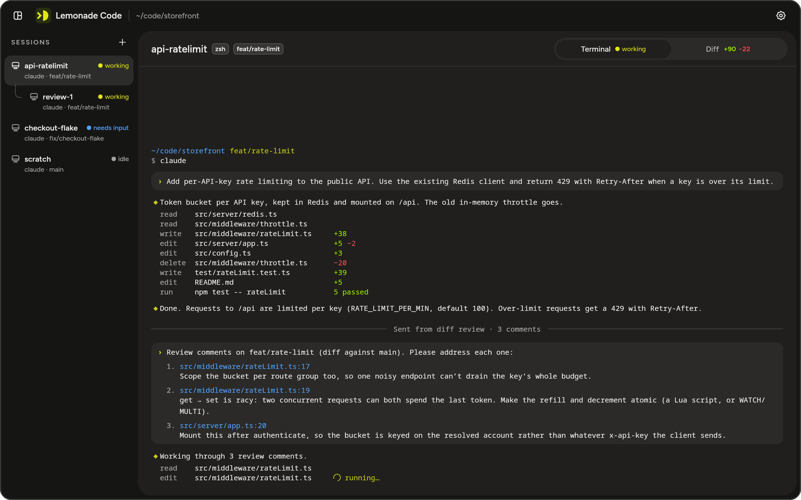

**New sub-session** opens a fresh session for the review, so the work starts with a clean context:
just your comments and a pointer to the diff.

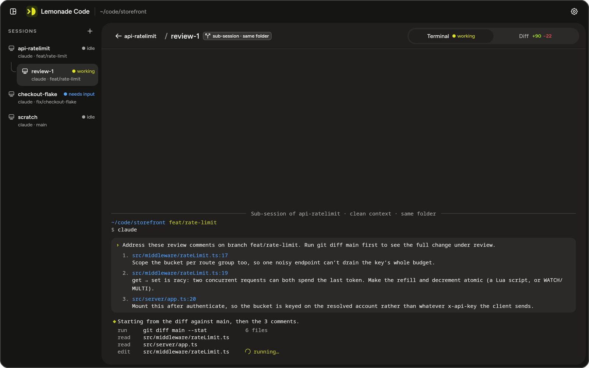

Sent comments remember where they went, so you can see which session is handling which note.

---

## Sub-sessions and worktrees

Split work off into sub-sessions. Each one is its own terminal, nested under the session it came
from.

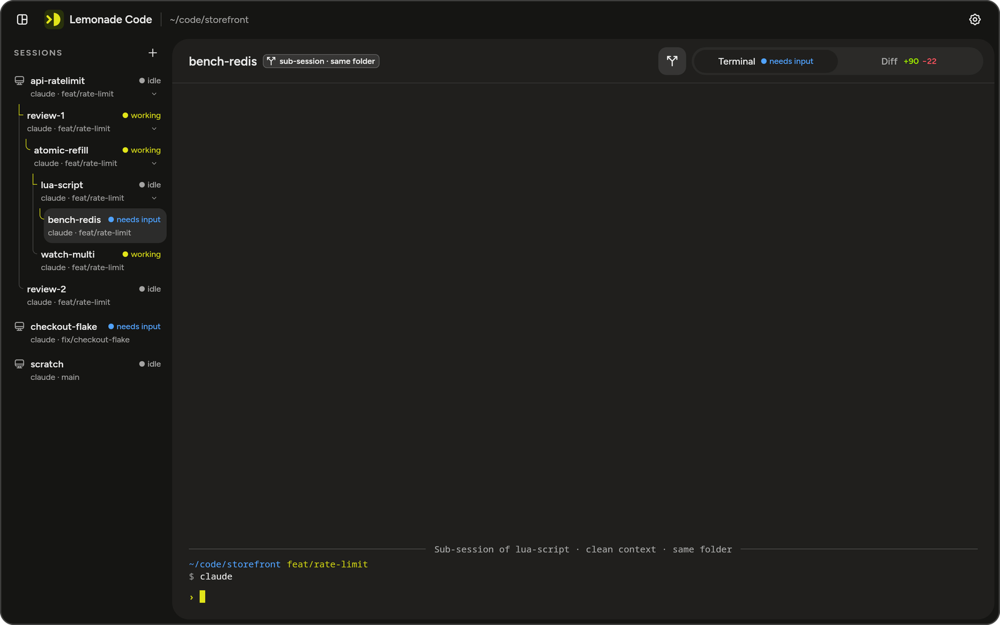

A sub-session can start in one of two places:

| | Same folder | New worktree |
|---|---|---|
| **Folder** | The parent's folder | A new folder next to the repository, named after the branch, like `storefront.worktrees/generating-bugs` |
| **Branch** | The parent's branch | A new branch you name, starting from the parent's |
| **Good for** | Reviews and quick follow-ups | Parallel work that must never collide |

A new worktree asks for its branch first, filled in with a playful suggestion like
`worktree/generating-bugs`. Press **Enter** to keep it, or type over it: everything is yours to
rename, `worktree/` included. The folder follows the name as you type. A name git won't take, or a
branch that already exists, is caught before anything is created. The same field opens from a
session's right-click menu.

Before anything is created, the panel shows you the exact folder and branch you'll get.

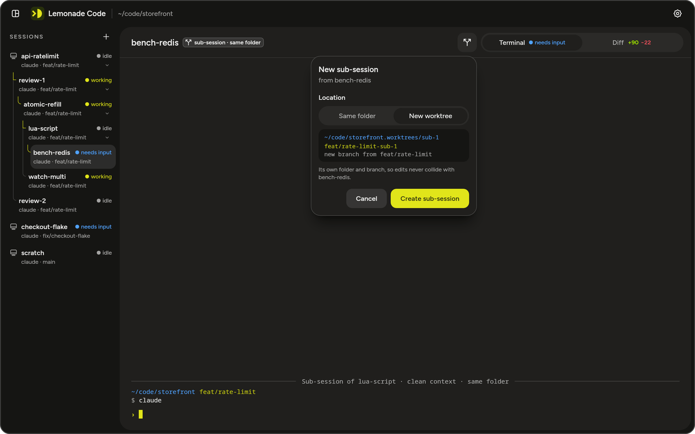

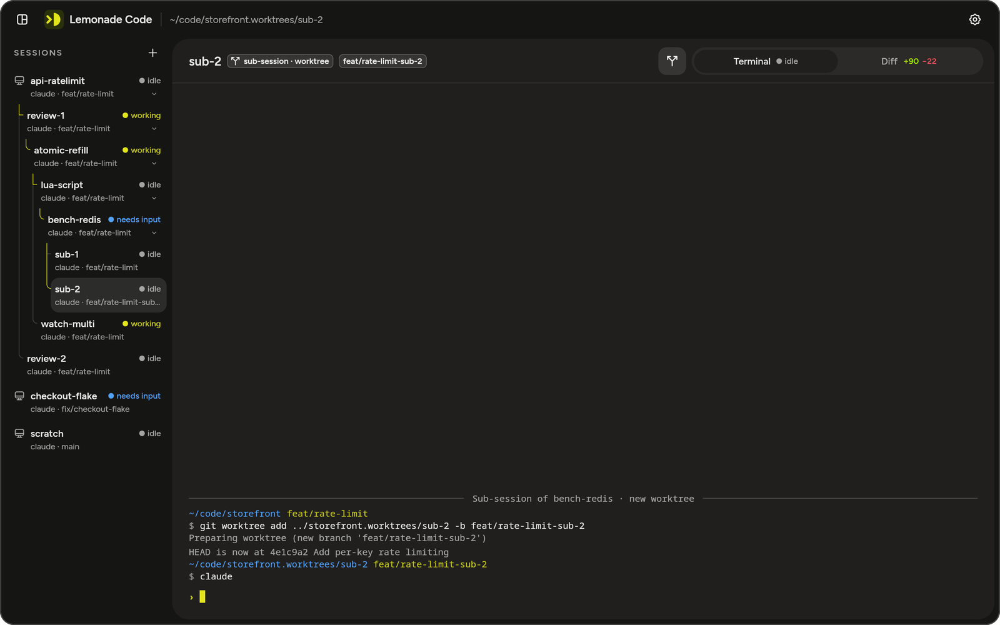

---

## File previews

Some files are easier to review when you can see them. These open on a **Preview** by default; the
chip in the file's header switches between the preview and the text diff.

| Kind | Files | Shown as |
|---|---|---|
| Images | PNG, JPEG, GIF, WebP, BMP, ICO | Before and after, side by side. Animated GIFs and WebPs play, with a pause button and a bar to scrub through their frames |
| Videos | MP4, MOV, M4V, WebM, MKV, AVI, OGV, MPEG | Before and after, side by side, with play, pause and a seek bar. They loop and play without sound |
| Vector art | SVG | Before and after, side by side |
| 3D models | STL, OBJ, PLY, glTF, GLB | Before and after, side by side. Drag to turn, ⌘ or Ctrl + scroll to zoom, double-click to reset |
| Documents | Markdown | Formatted, the way GitHub shows it: tables, task lists, quotes, alerts, code blocks, and the HTML READMEs use, like centered blocks, tables of screenshots and `
` |
| Data | CSV, TSV | A table |

Switch between **Before**, **After** and **Side by side** for any file that changed on both sides.

Pictures in a Markdown file show too. Pictures from the repository are read from the same side of
the change as the document, so the **Before** side shows the pictures as they were. Pictures from the
web, like badges, are downloaded when the preview opens.

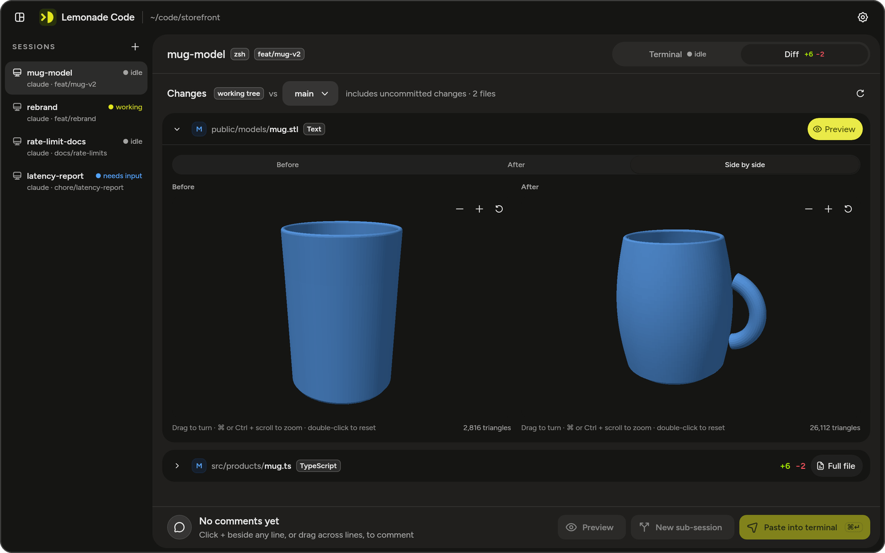

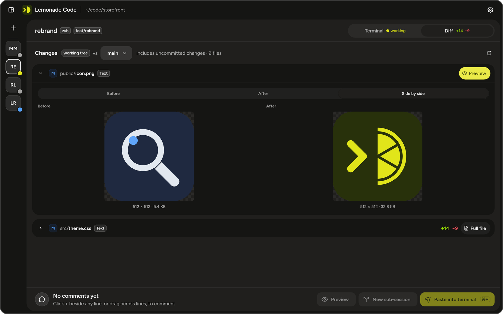

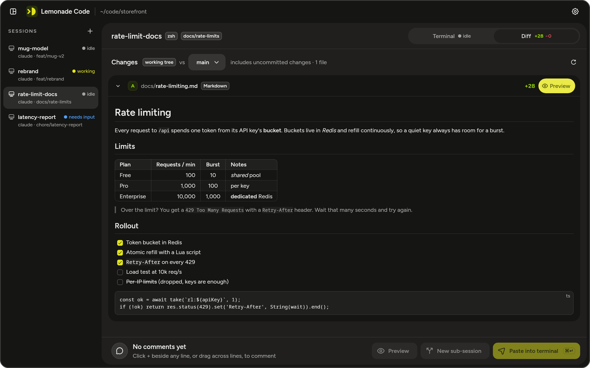

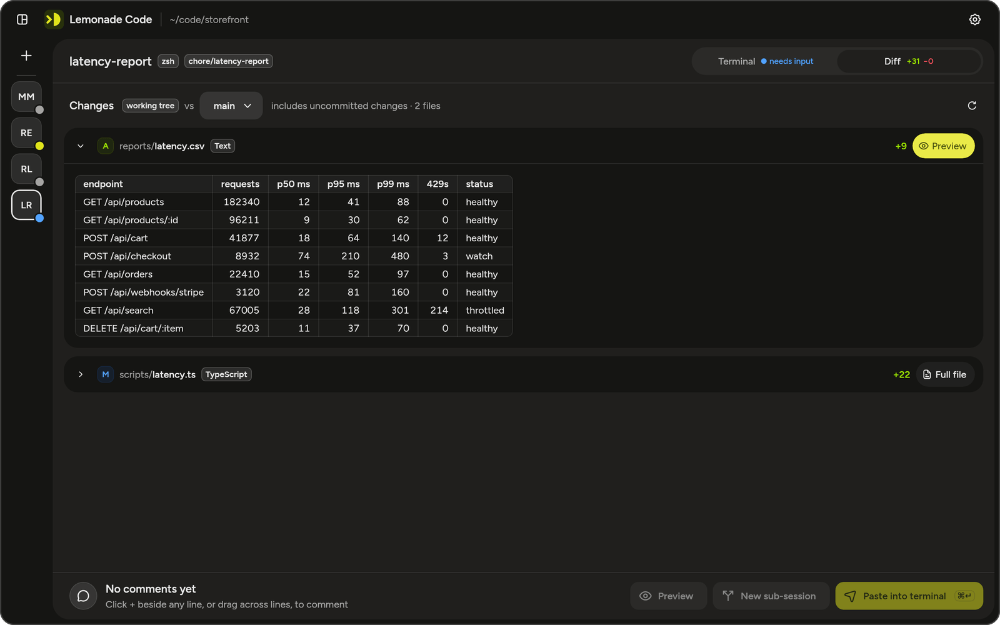

---

## Devices

Turn on **Settings › Plugins › Mobile** and a phone button joins the top bar, with the number of
devices connected. It opens the Devices panel at the right of the session. Android needs Android's
platform tools (`adb`); iPhones and iPads need [libimobiledevice](https://libimobiledevice.org).
Lemonade Code finds them on your `PATH`, in the Android SDK and in Homebrew's folder.

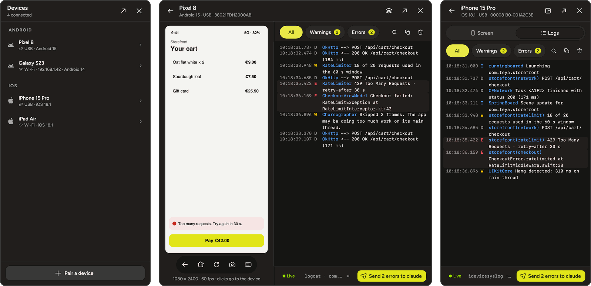

- **One step at a time.** The panel opens on the list of devices, Android and iOS apart. Pick one to
  see its screen beside its logs, or switch to tabs from the header.
- **Use the phone from here.** On Android, clicks and drags on the screen reach the phone, and so do
  Back, Home, turning it sideways and, with the keyboard button on, your typing. iPhones and iPads
  show their screen over a cable only, to look at.
- **Logs that matter.** Android shows the lines of the app in front; iOS shows the whole system log.
  Filter by level or by text, pause the stream while you read, or clear it.
- **Hand it to the agent.** **Send errors** pastes the error lines into the session's terminal,
  saying which device and log they came from. The camera button saves a screenshot and pastes its
  path, which Claude Code attaches as a picture. Nothing runs until you press Enter.
- **Pair new devices.** Pairing asks one thing per step: Android or iOS, then how. An Android phone
  scans a QR code, types a pairing code or is picked from the devices on your network with wireless
  debugging on. An iPhone is plugged in once and trusts this computer.
- **On another display.** The ↗ button moves the panel into a window of its own, and the main window
  gets its space back. The phone button gets a small ↗ mark and brings that window forward. ↙ puts
  the panel back.

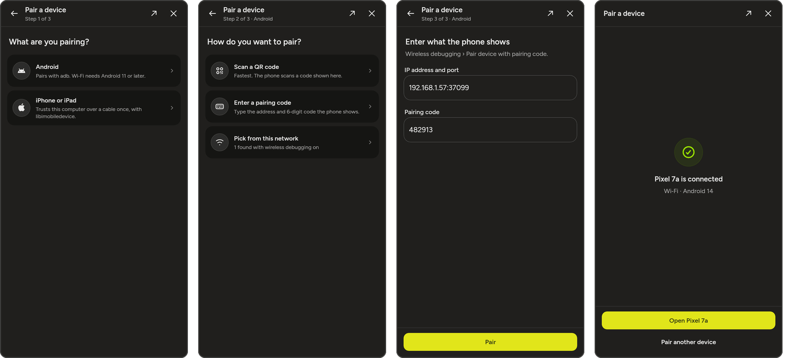

---

## Settings

The gear at the top right opens settings: a short list where every item shows its value. Open one to
change it on its own page; the back arrow or Esc returns to the list.

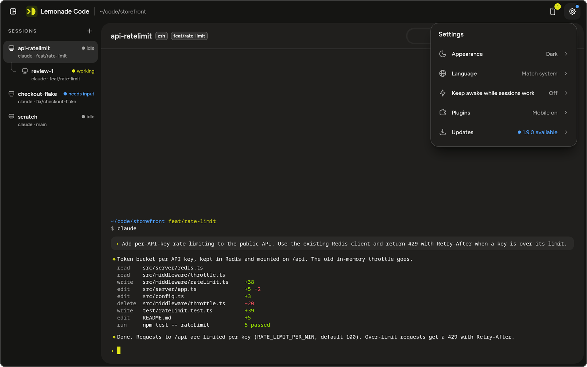

- **Appearance:** Dark, Light, or follow the System.
- **Language:** English, Deutsch, Español, Français, Português or Slovenčina, or match the computer's
  own. The whole app changes at once.
- **Keep awake while sessions work:** while any session is working, your computer won't go to
  sleep and the screen won't dim or lock. Once nothing is working, both behave as usual again. While
  it's holding the computer awake, a tag in the top bar says so.
- **Plugins:** turns on [Devices](#devices).
- **Updates:** the version you have, and the newer one when it's out.

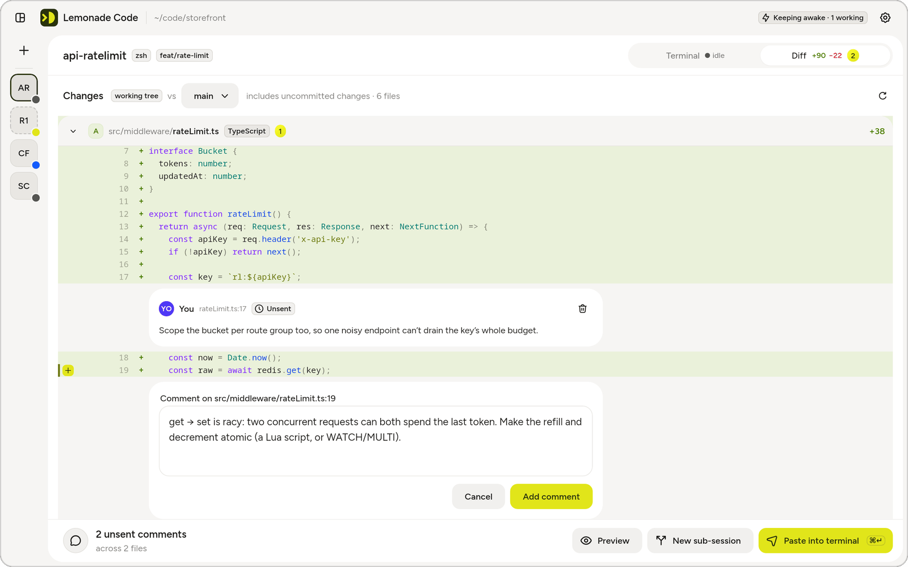

---

## Updates

Installed from a release file (DMG, MSI, .deb or tar.gz), Lemonade Code checks for a new version at
launch and every few hours, and whenever you press **Check for updates** in **Settings › Updates**.
When one is out, the gear gets a blue dot and the page says what's new. **Update now** downloads it
and checks it; **Restart now** puts the new version in place and brings your sessions back.

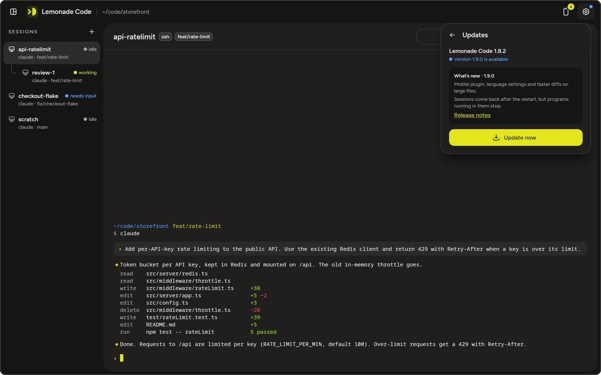

Installed with Homebrew or the Snap Store? Those update the app for you.

---

## Sessions come back

Quit whenever you like. Every session is saved: its name, where it sits in the tree, the folder its
shell was in and the last 1,000 lines it showed. Next time you open the app, each one comes back in
a fresh shell in that folder, with its old output above the new prompt.

If Claude Code was running in a session, its conversation is resumed too. Programs other than Claude
Code start fresh. Sessions are also saved while the app runs, so even after a crash you keep them
(just not their latest output).

---

## Shortcuts

On Windows and Linux, use **Ctrl** wherever you see **⌘**.

| Keys | Does |
|---|---|
| **⌘T** | New terminal session |
| **⌘W** | Close the selected session and its sub-sessions |
| **⌘↵** | Paste the unsent comments into the terminal |
| **Esc** | Close the open menu, panel or drawer |

In the terminal:

| macOS | Windows, Linux | Does |
|---|---|---|
| ⌘C | Ctrl+Shift+C | Copy the selection |
| ⌘V | Ctrl+Shift+V | Paste |
| ⌘A | Ctrl+Shift+A | Select everything |
| ⌘-click | Ctrl-click | Open a link |

With the mouse:

| Action | Does |
|---|---|
| Right-click a session | Rename, copy folder path, start a sub-session, close |
| Middle-click a session | Close it |
| Click **+** beside a line | Comment on that line |
| Drag across lines | Comment on a range |
| Drag a 3D model | Turn it around |
| Double-click / triple-click in the terminal | Select a word / a line |
