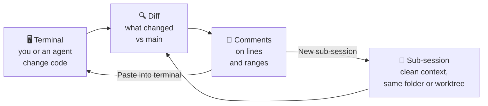

# How it works

What Lemonade Code does behind the scenes, in plain words. For the code itself, see
[Architecture](ARCHITECTURE.md).



- [Sessions](#sessions)
- [Full-screen programs](#full-screen-programs)
- [Following your shell](#following-your-shell)
- [Status](#status)
- [The diff](#the-diff)
- [Sending comments](#sending-comments)
- [Worktrees](#worktrees)
- [Saving and restoring sessions](#saving-and-restoring-sessions)
- [Keep awake](#keep-awake)
- [Sounds](#sounds)
- [Updates](#updates)
- [What goes over the network](#what-goes-over-the-network)

---

## Sessions

Each session runs your login shell (`$SHELL -l`) in a pseudo-terminal, the same thing a terminal
app gives you, starting in your home folder.

On Windows a session runs PowerShell in a ConPTY: `pwsh` if it's installed, otherwise Windows
PowerShell, otherwise `cmd.exe`. Your profile loads as usual.

## Full-screen programs

Programs like Claude Code's fullscreen mode, `vim` or `htop` draw on the terminal's *alternate
screen*. Like xterm's, it keeps no scrollback, so their repaints never pile up above your shell's
output, and leaving them brings that output right back. When such a program asks for mouse reports,
the wheel is sent to it, so it scrolls the program's own view.

## Following your shell

Every second, Lemonade Code asks the operating system which folder each shell is in (`lsof` on
macOS, `/proc` on Linux), then asks git which repository and branch that folder belongs to. That's
how the session name, the top bar, the diff and your comments keep up with every `cd`.

While a program the shell started holds the terminal, Lemonade Code asks for that program's folder
instead. A program can move without the shell: Claude Code entering a worktree changes its own folder
and leaves the shell's where it was. Once the program quits, the shell's folder counts again.

On Windows, the PowerShell prompt reports its folder to the terminal itself (with the OSC 9;9
escape sequence).

## Status

A session only shows a status while an agent reports one, so a plain shell shows none.

Claude Code sends a small probe when it starts (OSC 7501). Lemonade Code answers it, and from then on
Claude reports its own state, plus one for each background agent. The session then shows:

1. **needs input** if anything is blocked: a permission, a question or an error;
2. otherwise **working** if anything is busy, so a background agent counts even while the main one
   waits;
3. otherwise **idle**.

The status goes away when the agent quits, or once the shell has the terminal back if it crashed.

## The diff

The diff compares the folder's **working tree** (everything on disk now, committed or not, new files
included) with its **merge base**: the commit where the branch split off from the branch you compare
with.

Which branch is that?

1. The one you picked from the list next to **vs**, if any.
2. For a sub-session, its parent session's branch.
3. Otherwise the repository's default branch: origin's `HEAD`, else `main`, else `master`.

If that branch also has a copy on the remote (the branch it tracks, or else `origin`'s branch of the
same name), the newer of the two split points counts. So when your local `main` is behind
`origin/main`, what others merged since doesn't show up as yours, and when it's ahead, the commits
you haven't pushed yet don't either.

The list of branches starts with the default branch, then the parent session's, then the rest as
git lists them. The diff reloads when you open it, when you press refresh, and when the agent in the
terminal finishes working.

## Sending comments

**Paste into terminal** writes your comments into the terminal wrapped in bracketed-paste markers,
the same way your terminal pastes text, and doesn't press Enter. A shell won't run it, and an agent
waits for you to submit it.

**New sub-session** starts a sub-session of the current one, in the same folder, named `review-1`
(then `review-2`, and so on), and pastes the comments into it. They open with a line naming the
branch and the `git diff` to run first, so an agent there starts from the change under review and
nothing else.

## Worktrees

A sub-session in a **new worktree** gets its own branch, named by you, and its own folder next to
the repository, named after the branch's last part. The branch starts from the parent's:

```
~/code/storefront                               ← the repository, on feat/rate-limit
~/code/storefront.worktrees/generating-bugs     ← the sub-session, on worktree/generating-bugs
```

The name starts out as a playful suggestion, `worktree/` plus two random words. Lemonade Code checks
it against git's rules for branch names and against the branches the repository already has before
running `git worktree add`, so a bad name leaves nothing half-made behind.

Both share one git history, so the work can be merged back like any branch, but edits in one never
touch the other.

## Saving and restoring sessions

When you quit, Lemonade Code saves every session to `sessions.json`, next to your settings: its name,
its place in the tree, the folder it was in, and the last 1,000 lines it showed. Then it ends
the sessions and whatever was running in them.

At the next launch each session opens again in a fresh shell in the same folder, with its old output
above the new prompt. If that folder is gone, it starts at home instead.

If Claude Code was running, Lemonade Code finds which conversation it was in (from Claude's own
`~/.claude/sessions/<pid>.json`) and resumes it with `claude --resume <id>`. A conversation you
had already quit isn't resumed.

The file is also kept up to date while the app runs, so after a crash your sessions still come back,
just without their latest output.

## Keep awake

With **Keep awake while sessions work** turned on, Lemonade Code asks the operating system not to
sleep, dim or lock the screen while any session is working, and lets go as soon as none are:

| Platform | How |
|---|---|
| macOS | `caffeinate -d -i`, which keeps both the system and the display awake |
| Linux | `systemd-inhibit` blocking idle and sleep, plus `gnome-session-inhibit` on GNOME, which only listens to its own session manager |
| Windows | PowerShell calling `SetThreadExecutionState` with the system and display flags |

Each helper watches the app's process, so if the app is ever killed, the computer can sleep again
within seconds.

## Sounds

With **Sounds** on, as they are from the start, Lemonade Code listens to every session's
[status](#status), the one on screen or not:

- **working → idle** plays one ding: the agent finished.
- **→ needs input**, from anything else, plays a double ding, the second a little higher.

A session that just opened, or came back at launch, plays nothing until its status changes. A plain
shell, an agent quitting and a session that exited play nothing either. When several sessions change
within a third of a second, they play one sound, the double ding if any of them needs you.

The dings are drawn in code, a soft bell tone that fades away, and play through Java Sound on a
thread of their own. On a computer with no sound output, nothing plays.

## Updates

Installed from a release file (DMG, MSI, .deb or .tar.gz), the app looks for a newer release 10
seconds after launch and every 6 hours. A release counts when it's published, has a higher version
and carries both the file for your kind of install and a `SHA256SUMS` file.

When you press **Update and restart**, the app downloads the file, checks it against `SHA256SUMS`,
quits, and a small helper swaps the new version in and starts it again, sessions restored:

| Installed from | The helper |
|---|---|
| DMG | Copies the new app out of the DMG next to the old one, then swaps them |
| MSI | Runs `msiexec` to install the new MSI over the old one |
| .deb | Runs `pkexec dpkg -i`, which asks for your password |
| .tar.gz | Unpacks the new folder next to the old one, then swaps them |

Homebrew and Snap Store installs never check; those tools update the app themselves.

## What goes over the network

Only the update check: installs from a release file ask GitHub's public API which releases exist,
and download one when you press **Update**. Lemonade Code itself contacts nothing else, and your
code, sessions and comments stay on your computer. (Programs you run in its terminals, like Claude
Code, connect wherever they normally do.)
